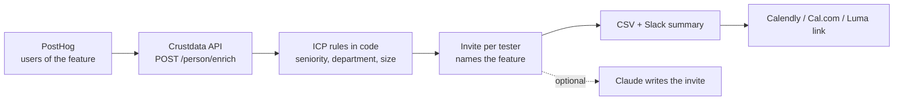

# Beta Tester Selector (Open Source, PostHog + Crustdata)

**An open-source Python tool that turns the list of people who used your new feature into a short list of beta testers who match your ICP, each with a ready-to-send invite.**

Feedback from the wrong people sends a roadmap the wrong way, and the first people to reply are often interns, students or someone at a company that will never buy. This tool takes your PostHog users, looks up each one's current role and company size with [Crustdata](https://crustdata.com), the people and company data layer ([API docs](https://docs.crustdata.com)), keeps only the ones who fit, and writes an invite that names the feature they used and links to your booking page.


## How it works



1. **Pull active users.** From a PostHog export (`--users file.csv` with a `profile_url` column) or straight from PostHog's query API for an event you name.
2. **Enrich.** One documented call, `POST /person/enrich`, 25 profiles per request. The tool reads the current role, seniority, department and company headcount.
3. **Apply the ICP in code.** Each rule reads the person's primary current role, so a title from one job is never mixed with the company size of another:
   - drop `In Training` and `Entry Level` seniority
   - keep only the departments you list (default: Product & Design, Engineering & Technology, Executive Leadership)
   - keep companies between 11 and 1000 people (both limits are flags)
   - drop profiles Crustdata cannot match or whose company size is unknown
4. **Write the invite.** A template by default; Claude drafts it when you pass `--claude`. Every invite names `FEATURE_NAME` and carries your `BOOKING_URL`.
5. **Hand off.** `out/invites.csv` and `out/results.json`, plus an optional Slack summary. Load the CSV into your email tool, or paste the booking link flow into Calendly, Cal.com or Luma. People already invited are skipped on later runs (`.state/seen.json`), before any enrichment is paid for.

## Quickstart

Requires Python 3.9+. No dependencies for the core tool.

```bash
git clone https://github.com/mhimed-crustdata/beta-tester-selector
cd beta-tester-selector
make setup        # creates .env, then add your CRUSTDATA_API_KEY
make demo         # uses examples/users.example.csv, never posts to Slack
make run          # same input, posts the summary to SLACK_WEBHOOK_URL
make test         # unit tests, no network
```

With your own data: `python3 selector.py --users posthog_export.csv --feature "Session Replay Filters"`. Without `--users` it queries PostHog (see below).

Run it right after a feature enters beta, or on a schedule with cron (`0 8 * * 1 cd /path/to/repo && python3 selector.py`).

## Configuration

| Variable | Default | What it does |
|---|---|---|
| `CRUSTDATA_API_KEY` | required | Your Crustdata API key. Read from the environment only |
| `FEATURE_NAME` | `the new feature` | Named in every invite |
| `BOOKING_URL` | placeholder | Link to your Calendly, Cal.com or Luma page |
| `SINCE_DAYS` | `30` | PostHog look-back window |
| `POSTHOG_PROJECT_ID`, `POSTHOG_PERSONAL_API_KEY` | empty | Needed only when you skip `--users` |
| `POSTHOG_HOST` | `https://us.posthog.com` | Use `https://eu.posthog.com` for EU projects |
| `POSTHOG_EVENT` | `beta_feature_used` | The event that means "used the feature" |
| `POSTHOG_PROFILE_PROPERTY` | `profile_url` | Person property holding the professional profile URL |
| `SLACK_WEBHOOK_URL` | empty | Slack incoming webhook. Empty means no Slack post |
| `ANTHROPIC_API_KEY` | empty | Optional Claude step |
| `ANTHROPIC_MODEL` | `claude-opus-5-5` | Model for the optional Claude step |

ICP flags: `--departments`, `--reject-seniority`, `--min-headcount`, `--max-headcount`. Output files in `out/` contain personal data and are git-ignored.

## Example output

A real run against the live API on 2026-11-04 with the default ICP. The input was 15 profiles sampled by current title (product managers, interns, software engineers) as a stand-in for a feature's users. Individuals are not shown. Aggregated from `out/results.json`:

```json
{
  "users_checked": 15,
  "matched_in_crustdata": 15,
  "icp_fit": 6,
  "fit_share_pct": 40,
  "dropped_by_reason": {
    "company size": 4,
    "department": 1,
    "company size unknown": 1,
    "seniority": 3
  },
  "fit_by_company_size": {
    "11-50": 1,
    "51-200": 1,
    "201-1000": 4
  },
  "fit_by_department": {
    "Executive Leadership": 2,
    "Product & Design": 1,
    "Engineering & Technology": 3
  }
}
```

Three of the 15 were interns or trainees, and four sat at companies with more than 1000 people. Those are the people a first-come-first-served invite would have included.

What the Slack summary looks like (redacted):

```text
:test_tube: 6 of 15 Session Replay Filters users fit the ICP and got a beta invite draft
• [First name], [Title] at [Company] ([headcount] people, [n] uses)
```

And an invite:

```text
Hi [First name], you tried Session Replay Filters while it was in beta, and your take as a [Title] would help us a lot. Could you spare 20 minutes for a feedback call? Pick a time here: [booking link]
```

## How to build a beta tester recruiting agent

1. **Define who you want as data.** Write the ICP as seniority, department and company size, not as a feeling about a reply.
2. **Use one documented Crustdata call.** `POST /person/enrich` returns the current role and company size for each profile URL.
3. **Write the rules in code, not in a prompt.** Check them against the primary role so nested matches cannot mix two jobs.
4. **Only invite once.** Keep a seen list and skip those people before you enrich.
5. **Use the model for the words, not the list.** Claude drafts the invite; the code decides who gets one.
6. **Send it where booking happens.** The booking link in the invite goes to Calendly, Cal.com or Luma, and the CSV drops into any email tool.

## FAQ

**How to recruit beta testers?**
Start from people who already used the feature, then keep the ones whose role and company match your ICP instead of whoever replies first. This tool does that filter with Crustdata and drafts the invite.

**Why does the code filter instead of asking a model to judge?**
Rules in code give the same answer every run and can be unit tested. The model only writes the invite text, and the tool falls back to a template if the model is off, declines, or drops the booking link.

**Does it use company funding?**
Not yet. `POST /person/enrich` returns company size, industry and type for the current role. Add a company lookup in `evaluate()` if funding stage is part of your ICP.

**Does it contact anyone?**
No. It writes invites to `out/` and only posts a summary to your own Slack webhook when `SLACK_WEBHOOK_URL` is set and `--dry-run` is off.

**Is Claude required?**
No. It is optional and off unless `ANTHROPIC_API_KEY` is set and you pass `--claude`.

**Which Crustdata endpoint does it use?**
`POST /person/enrich` on API version `2025-11-01`. See the [Crustdata API docs](https://docs.crustdata.com).

## Project layout

```text
selector.py         # the workflow: users, enrich, ICP rules, invites
crustdata_api.py    # tiny Crustdata client (stdlib only)
notify.py           # optional Slack + Claude
examples/           # sample input CSV
tests/              # unit tests, no network
```

## License

MIT. See [LICENSE](LICENSE). Data layer: [Crustdata](https://crustdata.com) ([docs](https://docs.crustdata.com)).
